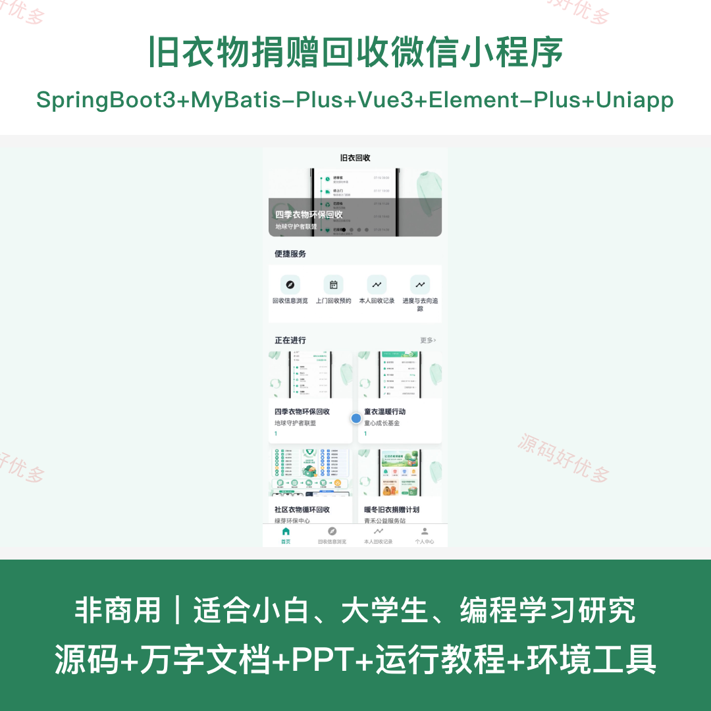
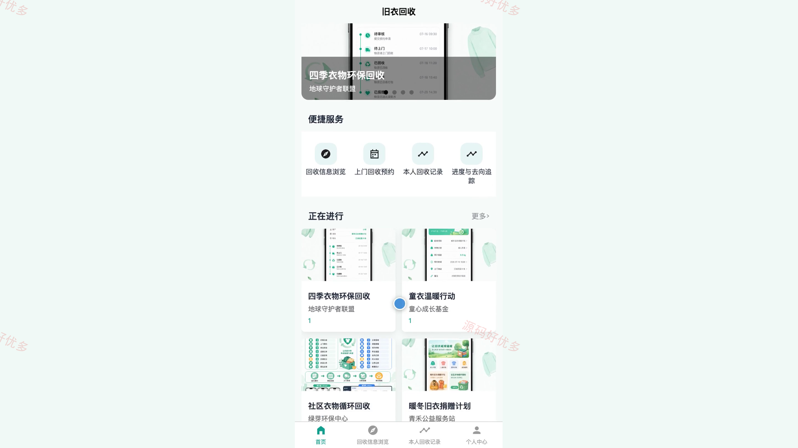
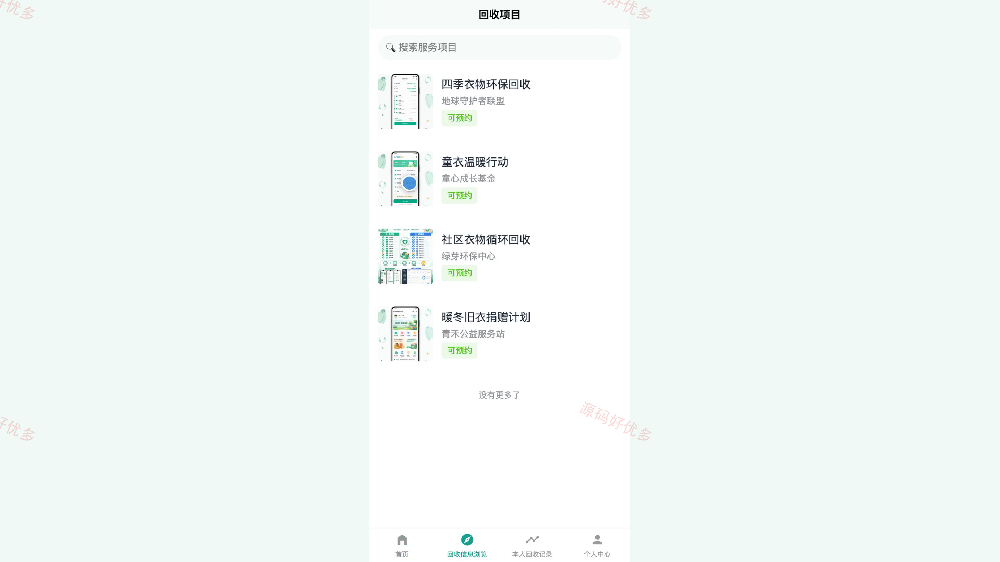
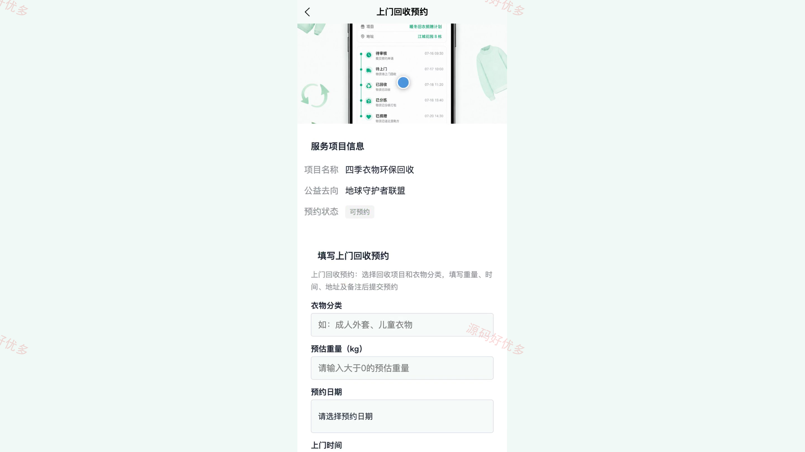
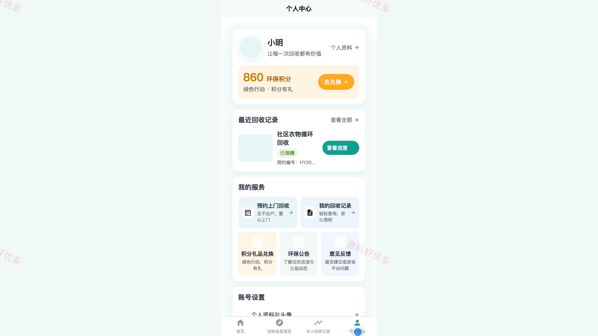
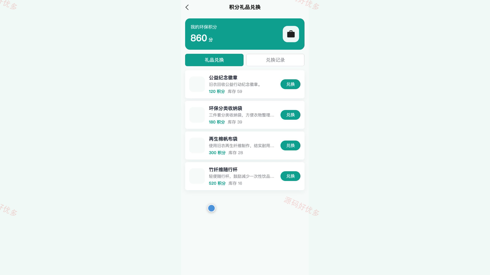
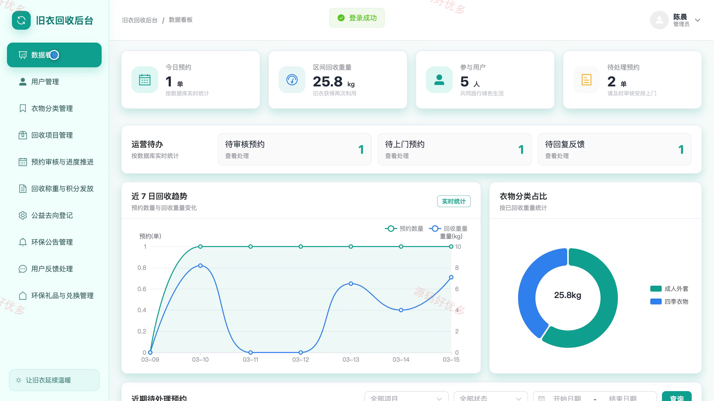
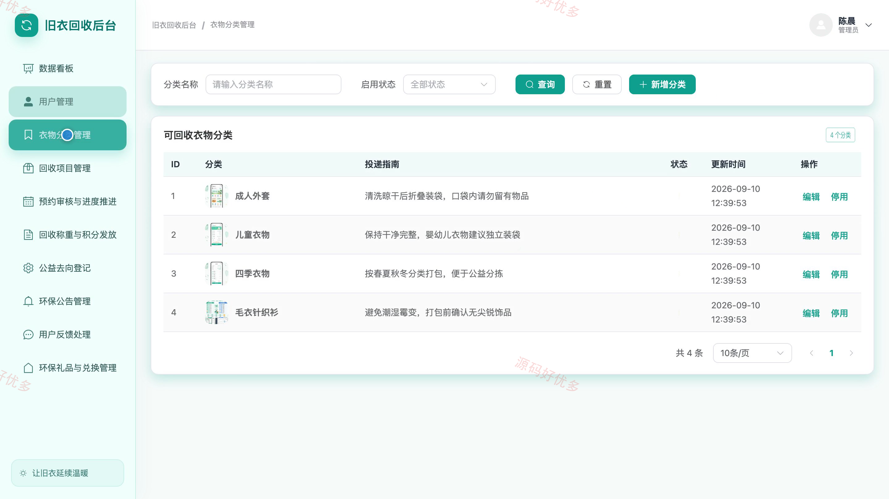
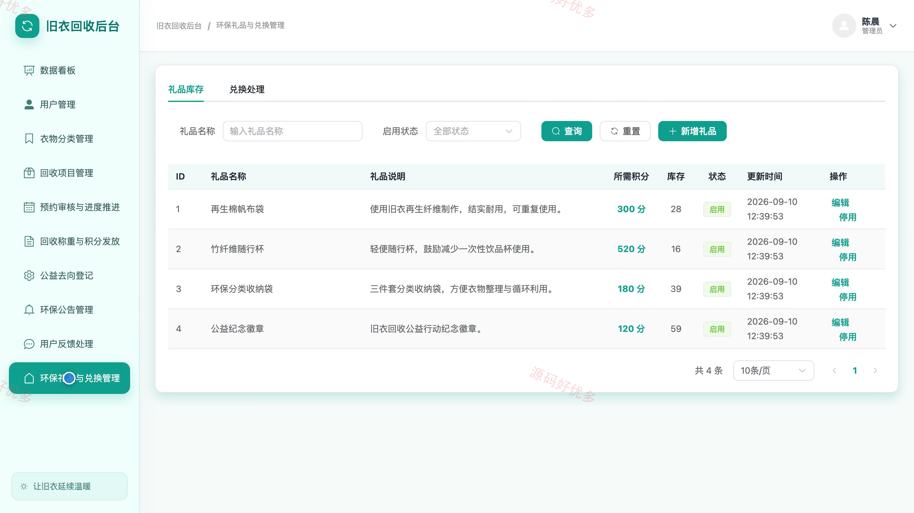

# bs102B
bs102B旧衣物捐赠回收小程序源码 Java SpringBoot3 Vue3 文档 PPT
## 源码问题查看主页咨询

### 一、关键词
旧衣回收、衣物捐赠、上门回收预约、公益去向追踪、绿色积分兑换

### 二、作品包含
源码+数据库+万字设计文档+PPT+全套环境和工具资源+本地部署教程

### 三、项目技术
前端技术： Html、Css、Js、Vue3.4、Element-Plus、uniapp
后端技术：Java、SpringBoot3.2.0、MyBatis-Plus

### 四、运行环境要求
开发工具：IDEA/eclipse + VSCODE + HBuilder X + 微信开发者工具

数据库：MySQL5.7+（共12张表）

数据库管理工具：Navicat10以上版本

环境配置软件： JDK17 + Maven3.6

前端Nodejs：20

浏览器：谷歌浏览器

### 五、项目介绍
项目编号：bs102B

旧衣物捐赠回收小程序面向社区用户与平台管理员，围绕旧衣回收项目浏览、上门预约、回收进度、公益去向和绿色积分形成服务闭环。用户可在小程序端提交预约并查询回收记录、捐赠凭证和积分礼品；管理员通过后台审核预约、登记称重、发放积分并维护回收项目、公告、反馈和公益去向。

角色：用户、管理员

用户功能：账号注册登录与个人资料维护、回收项目和衣物分类浏览、上门回收预约提交、个人回收记录与处理进度查询、公益去向和捐赠凭证追踪、绿色积分查询与环保礼品兑换、环保公告查看、意见反馈提交与结果查看。

管理员功能：回收业务数据看板、用户账号与状态管理、衣物分类和回收项目管理、上门预约审核与进度推进、回收称重和绿色积分发放、公益去向与捐赠凭证登记、环保公告和用户反馈处理、环保礼品与兑换记录管理。

### 六、运行截图

